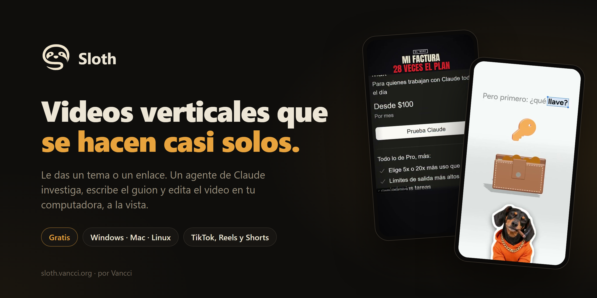
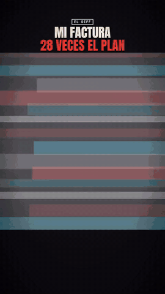
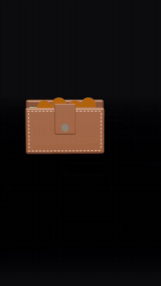
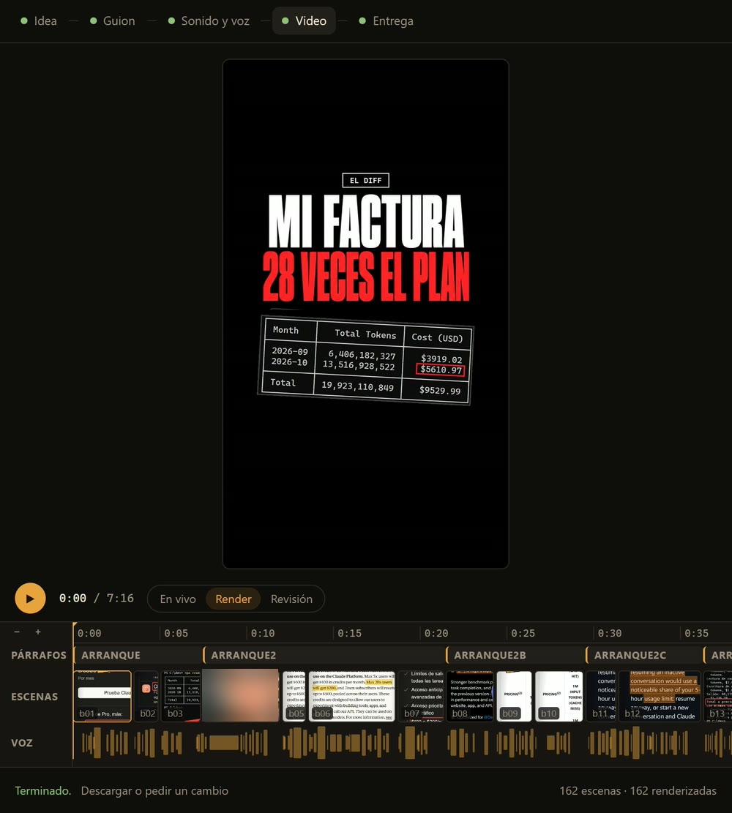

<p align="center">
  
</p>

<p align="center">
  <a href="https://sloth.vancci.org"></a>
  
  
  <a href="LICENSE"></a>
</p>

<p align="center">
  <a href="https://api.sloth.vancci.org/descargar"><b>Descargar</b></a> ·
  <a href="https://sloth.vancci.org">Página</a> ·
  <a href="https://sloth.vancci.org/ias">Las IA</a> ·
  <a href="https://sloth.vancci.org/estilos">Estilos</a> ·
  <a href="https://sloth.vancci.org/preguntas">Preguntas</a> ·
  <a href="https://sloth.vancci.org/#roadmap">Roadmap</a> ·
  <a href="https://sloth.vancci.org/#apoyar">Apoyar</a> ·
  <a href="CONTRIBUTING.md">Aportar</a>
</p>

---

**Sloth** es una app gratis de escritorio (Windows, Mac y Linux) para hacer videos con IA: verticales para TikTok,
Reels y Shorts, u horizontales para YouTube. Eliges un estilo, le das un tema o un enlace, y un agente de IA
investiga, escribe el guion, te pide tu voz (o usa una voz de IA) y edita el video en tu computadora. No es una caja
negra: lo ves trabajar paso a paso y le pides cambios con tus palabras.

Es gratis, sin tarjeta, sin créditos y sin límite de videos. Trabaja con la IA que ya tengas, y eliges el modelo:
Claude, ChatGPT, Google Antigravity (Gemini, gratis o con Google AI Pro y Ultra), OpenCode (que tiene modelos gratis)
y otras diez. [Qué pide cada una](https://sloth.vancci.org/ias).

> **In English:** Sloth is a free, open-source (MIT) desktop app for Windows, macOS and Linux that turns a topic or a
> link into a finished video for TikTok, Reels, Shorts or YouTube. The AI you connect (Claude, ChatGPT/Codex, Google
> Antigravity/Gemini, OpenCode, DeepSeek, OpenRouter, Ollama, Grok, Cursor…) researches, scripts, edits and renders it on your
> computer. It also publishes to TikTok, Instagram and YouTube, makes images and clips (Google Flow, ChatGPT, Google
> Vids, Meta Muse), AI voices and free local subtitles. Unlimited videos, no per-video fee. The app is in Spanish.

## Ejemplos

<table>
  <tr>
    <td align="center" width="50%">
      <br>
      <b>El Diff</b><br>
      <sub>Tu noticiero vertical, con tu nombre, tu sello y tu despedida. De una a dos horas por episodio.</sub>
    </td>
    <td align="center" width="50%">
      <br>
      <b>Video explicativo</b><br>
      <sub>Cualquier tema en un mundo 3D que la cámara recorre sin cortes, con el texto palabra por palabra. Unos 40 minutos.</sub>
    </td>
  </tr>
</table>

<p align="center"><a href="https://sloth.vancci.org">Míralos completos y con sonido en sloth.vancci.org</a></p>

## Estilos

Todos vienen incluidos y gratis ([detalle](https://sloth.vancci.org/estilos)):

| Estilo | Qué hace |
| --- | --- |
| **El Diff** | Tu noticiero con tu nombre, tu sello y tu despedida, con la prueba de cada dato a la vista. O sus shorts. |
| **Video explicativo** | Cualquier tema en un mundo 3D que la cámara recorre sin cortes, con tu personaje. |
| **Documental** | Tu grabación a cámara cubierta con material real de internet, recoloreado y animado a golpe de corte. |
| **Low-Poly** | Un proceso (el ciclo del agua, del cafetal a tu taza) en un mundo en miniatura de papel facetado. |
| **Frutinovela** | Una telenovela de frutas en 3D que hablan, hecha en Google Flow con tus cuentas de Google. |
| **Reel de comedia** | Un experto muy serio con pasos absurdos, con tus poses recortadas sobre fotos reales. |
| **Motion Graphics** | Anuncios y campañas con montaje musical o narración y tipografía cinética. |
| **Nuevo estilo** | Le cuentas el video que quieres, o le pasas ejemplos, y arma tu propio estilo. |

Dentro de la app hay además una tienda con más de 20 estilos de la comunidad.

## Cómo funciona

Cada estilo de video es una **card**. Escribes qué quieres y el agente avanza por cinco fases, que ves en el estudio:

| Fase | Qué pasa |
| --- | --- |
| **Idea** | Investiga el tema: lee el enlace, busca las fuentes y junta el material (capturas, clips, datos). |
| **Guion** | Escribe el guion en el tono del estilo, con su gancho de 3 segundos y su cierre. |
| **Sonido y voz** | Te pide tu voz (la grabas con el celular) o usa una voz de IA. |
| **Video** | Arma cada escena con Remotion y la renderiza en tu computadora. |
| **Entrega** | El video final con su portada, listo para descargar o publicar. Si algo no te gusta, se lo dices. |

<p align="center">
  
</p>

## Lo que trae, además del video

| Qué | Cómo |
| --- | --- |
| **Redes** | Sube y programa en TikTok, Instagram y YouTube con tus cuentas, con calendario. El piloto hace los videos: en manual esperan tu revisión; en automático (lo enciendes tú) salen solos. En YouTube, la IA escribe la descripción y los capítulos. |
| **Imágenes** | Un estudio para pedir imágenes a Google Flow o ChatGPT, con editor por zonas y «Quitar fondo» en tu computadora. |
| **Clips con IA** | Los agentes generan clips con Google Flow, Google Vids (sin gastar los créditos de Flow) y Meta Muse (clips de 10 s con sonido), con tus cuentas. |
| **Voz** | Tu voz grabada con el celular, o una de IA: Google AI Studio gratis, o Fish Audio, ElevenLabs, Vibi y Groq con tu llave. Quien apoya, además, le dicta a Sloth con el micrófono. |
| **Subtítulos** | Gratis, en la entrega de cada video: se hacen en tu computadora, sin tokens, en el video o en `.srt`. |
| **Varias cuentas** | Varias de Claude, ChatGPT y Google: si una llega a su límite, el video sigue con otra. Junto a cada modelo, cuánto cuesta y tarda un minuto de video. |
| **Desde donde estés** | Sloth en la web (tu Sloth desde el navegador del celular u otra computadora), Sloth en la nube (un Codespace de tu GitHub), la app de Android (GAMMA) y tu Sloth en otra computadora con tu clave. |
| **A tu medida** | «Sobre ti» (lo que todos los agentes saben de ti), «Afinar» (reescribe tu pedido para el estilo), los temas Sloth y Cristal, y la actividad de cada agente. |

## Instalar

Descarga la última versión para tu sistema y ábrela:

| Sistema | Descarga | Nota |
| --- | --- | --- |
| **Windows** 10 u 11 | [Sloth para Windows](https://api.sloth.vancci.org/descargar) | Si dice «Windows protegió tu PC», da clic en *Más información* y luego en *Ejecutar de todas formas*. |
| **Mac** con Apple Silicon (M1 o más nueva) o con Intel, macOS 13 o más nuevo | [Sloth para Mac](https://api.sloth.vancci.org/descargar?so=mac) | La página deja elegir la de tu Mac. |
| **Mac** con Intel y macOS 12 | [Sloth para macOS 12](https://api.sloth.vancci.org/descargar?so=mac12) | Una versión aparte, con Electron 43. |
| **Linux** | [Sloth para Linux](https://api.sloth.vancci.org/descargar?so=linux) | Es un AppImage: dale permiso de ejecutar y ábrelo. |
| **Android** (GAMMA) | [Sloth en el celular](https://sloth.vancci.org/#celular) | Controla tu Sloth de la computadora con un QR. |

FFmpeg, Python y lo que pide cada estilo los instala la propia app. Las versiones nuevas se instalan desde la misma
app; lo que trae cada una está en [Releases](https://github.com/Vancci-sloth/sloth/releases).

## Tu IA

Necesitas una IA conectada; con una basta. Sloth no cobra por video: lo que gasta es de tu IA, con tu cuenta.

| IA | Qué necesitas |
| --- | --- |
| **Claude** | Claude Pro o Max, o llave de API |
| **ChatGPT** (Codex) | ChatGPT Plus o Pro, o llave de API. Con ella, Sloth también hace las imágenes |
| **Google Antigravity** | Cualquier cuenta de Google: cuota gratis semanal, o la de Google AI Pro o Ultra. Varias cuentas a la vez |
| **OpenCode** | Cuenta gratis de opencode.ai, con modelos gratis |
| **Gemini** | Llave de API de Google AI Studio |
| **Cursor**, **Muse Code** | Tu cuenta |
| **DeepSeek**, **OpenRouter**, **FreeLLMAPI**, **Grok**, **Pi**, **omp** | En beta: su llave o su cuenta |
| **Ollama** | En beta: los modelos que tengas en Ollama, en tu computadora o en su nube, con 64k de contexto o más |

**Eliges el modelo:** en «Avanzado» eliges modelo y esfuerzo en cada hilo, entre los que tu IA da a tu cuenta (con
Antigravity, exactamente los que Google te ofrece: Gemini, Claude y GPT). En «Optimizado», Sloth usa el que midió como
mejor para cada estilo. A precio de API, con Claude Sonnet, un video explicativo corto cuesta de $0.27 a $0.38 USD y
un El Diff de 6 minutos, unos $2. [Todo sobre las IA](https://sloth.vancci.org/ias).

## Correrla desde el código

Necesitas Node 24.

```bash
git clone https://github.com/Vancci-sloth/sloth.git
cd sloth
npm ci
npm start
```

`npm start` levanta el servidor en `http://localhost:4848` y abre la ventana de Sloth. Sus agentes leen las skills de
`skills/` de este repo, con su propia configuración de Claude en `data/claude` (la cuenta se conecta una vez desde
Sloth): tu `~/.claude` no cambia, y una Sloth instalada en la misma computadora sigue con las suyas.

Antes de dar algo por hecho: `npm run typecheck`, `npm test` y, si tocaste `skills/`, `npm run comprobar-skills`.

## Cómo está hecha

| Pieza | Con qué |
| --- | --- |
| La ventana | [Electron](https://www.electronjs.org), con instalador y actualizaciones que bajan solo lo que cambió |
| La interfaz | React y Vite (`web/`) |
| El servidor local | Node (`server/`): sesiones, estudio, galerías, comunidad y requisitos |
| Los agentes | [Claude Agent SDK](https://docs.anthropic.com/en/docs/claude-code/sdk), Codex, OpenCode y otros por ACP, cada uno con tu cuenta (`server/`) |
| Los videos | [Remotion](https://www.remotion.dev) en cada estilo, y Python para transcribir y descargar |
| El cobro y la comunidad | Un Worker de Cloudflare con D1 y R2 (`licencias/`) |

```
electron/   la ventana de escritorio
server/     el servidor local que corre los agentes
web/        la interfaz
shared/     los tipos que comparten servidor e interfaz
skills/     los estilos de video y sus herramientas (video-base es lo que comparten)
movil/      la app del celular (Expo)
licencias/  el cobro del apoyo, la comunidad y las descargas (Cloudflare Worker)
nube/       la nube que publica en Instagram (Cloudflare Worker)
python/     los procesos de Python de Sloth
scripts/    compilar, publicar y desplegar
docs/       las decisiones (adr/) y las guías para agentes (agents/)
```

Las reglas del proyecto y el mapa del código están en [`AGENTS.md`](AGENTS.md) y
[`docs/agents/mapa.md`](docs/agents/mapa.md).

## Roadmap

Las metas se cuentan con las personas que apoyan hoy, y la comunidad vota el orden dentro de Sloth.
[Míralo en vivo en la página](https://sloth.vancci.org/#roadmap).

## Apoya a Sloth

Sloth es gratis y lo seguirá siendo. Si te sirve, puedes [apoyarla](https://sloth.vancci.org/#apoyar): empieza en
$10 USD al mes y sube $5 por cada 50 personas que apoyan (tu precio no sube mientras sigas), o de una vez desde $1.
Quien apoya tiene los estilos de la comunidad, cada versión 7 días antes, el dictado por voz, YouTube con un clic (la
app de Google de Sloth), su insignia y Sloth sin el recordatorio. Se paga con tarjeta, Mercado Pago o cripto. La mitad
de lo que entra con tarjeta se reparte entre quienes comparten estilos.

## Preguntas frecuentes

- **¿Es gratis?** Sí, sin límite de videos. Lo que gasta un video es de tu IA.
- **¿Funciona con ChatGPT Plus, Claude Pro o Google AI Pro?** Sí. Google AI Pro y Ultra van por Antigravity.
- **¿Puedo elegir el modelo, por ejemplo uno de Gemini?** Sí, en «Avanzado», entre los que tu IA da a tu cuenta.
- **¿Puedo usarla sin pagar una IA?** Sí, con límites: OpenCode tiene modelos gratis y Antigravity, cuota gratis semanal.
- **¿Cuánto tarda un video?** Un explicativo, unos 40 minutos; un El Diff, de una a dos horas.
- **¿Publica en mis redes?** Sí: sube y programa en TikTok, Instagram y YouTube con tus cuentas, y con el piloto
  automático los hace y los publica solos.
- **¿Pone subtítulos?** Sí, gratis y en tu computadora.
- **¿La puedo usar desde el celular?** Sí: con Sloth en la web, desde el navegador, o con la app de Android (GAMMA).

[Todas las preguntas](https://sloth.vancci.org/preguntas).

## Aportar

Los PRs son bienvenidos. Lee [`CONTRIBUTING.md`](CONTRIBUTING.md) antes de empezar: la interfaz va en español, la
paleta es la de Sloth y cada cambio se comprueba en Windows, Mac y Linux. Para reportar un problema de seguridad, no
abras un issue: sigue [`SECURITY.md`](SECURITY.md).

## Créditos

El estilo **Documental** parte de EDITOR V1, de [NextPhase AI](https://www.skool.com/nextphase-5790/about), que
venía para HyperFrames; en Sloth se dibuja con Remotion.

## Licencia

**Código abierto, con la [licencia MIT](LICENSE)**, a nombre de [Vancci](https://vancci.org). Puedes usar Sloth para
lo que quieras, modificarla y compartirla; solo conserva el aviso de la licencia. Los videos que hagas son tuyos.
Sloth es gratis y se sostiene con quien [la apoya](https://sloth.vancci.org/#apoyar). El nombre y el logo de Sloth no
entran en la licencia: si publicas una versión modificada, ponle otro nombre.

Remotion, que arma los videos, tiene su [propia licencia](https://www.remotion.dev/license): gratis para personas y
equipos pequeños; las empresas más grandes pagan la suya. Sloth no está afiliada, patrocinada ni respaldada por
Anthropic, OpenAI, Google ni las demás marcas que se nombran aquí.

<p align="center"><sub>Hecho por <a href="https://vancci.org">Vancci</a> en México</sub></p>
