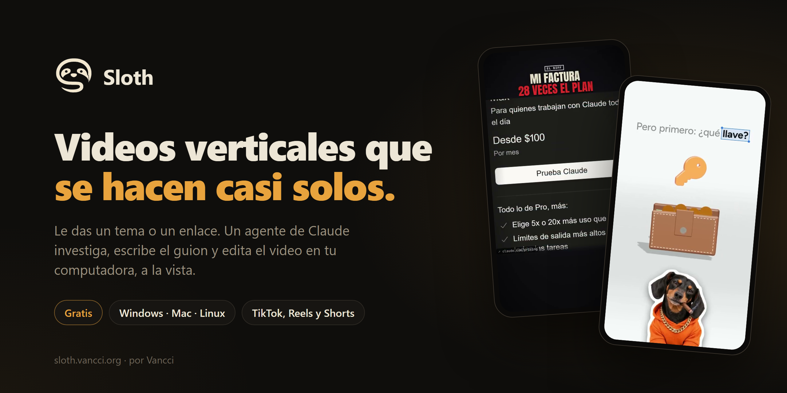
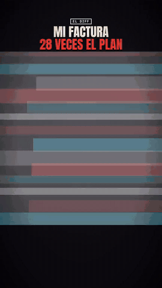
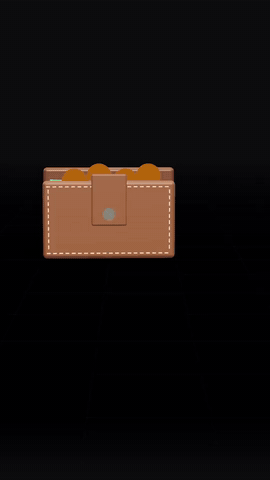
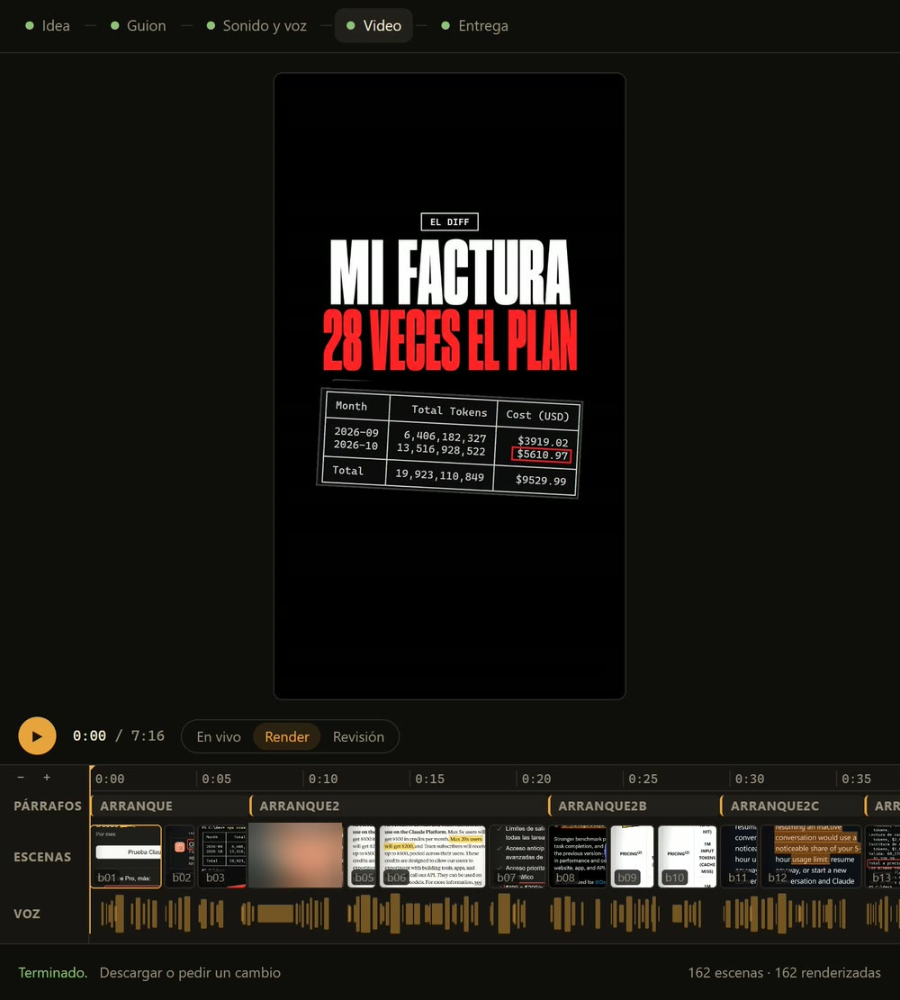

<p align="center">
  
</p>

<p align="center">
  <a href="https://sloth.vancci.org"></a>
  
  
  <a href="LICENSE"></a>
</p>

<p align="center">
  <a href="https://api.sloth.vancci.org/descargar"><b>Descargar</b></a> ·
  <a href="https://sloth.vancci.org">Página</a> ·
  <a href="https://sloth.vancci.org/#roadmap">Roadmap</a> ·
  <a href="https://sloth.vancci.org/#apoyar">Apoyar</a> ·
  <a href="CONTRIBUTING.md">Aportar</a>
</p>

---

**Sloth** es una app de escritorio que hace videos verticales para TikTok, Reels y Shorts. Eliges un estilo, le das
un tema o un enlace, y un agente de Claude investiga, escribe el guion, te pide tu voz y edita el video en tu
computadora. No es una caja negra: lo ves trabajar paso a paso y le pides cambios con tus palabras.

Es gratis, sin tarjeta y sin límite de videos. Trabaja con tu propia cuenta de Claude.

## Ejemplos

<table>
  <tr>
    <td align="center" width="50%">
      <br>
      <b>El Diff</b><br>
      <sub>Tu noticiero vertical, con tu nombre, tu sello y tu despedida. De una a dos horas por episodio.</sub>
    </td>
    <td align="center" width="50%">
      <br>
      <b>Video explicativo</b><br>
      <sub>Cualquier tema en un mundo 3D que la cámara recorre sin cortes, con el texto palabra por palabra. Unos 40 minutos.</sub>
    </td>
  </tr>
</table>

<p align="center"><a href="https://sloth.vancci.org">Míralos completos y con sonido en sloth.vancci.org</a></p>

## Cómo funciona

Cada estilo de video es una **card**. Escribes qué quieres y el agente avanza por cinco fases, que ves en el estudio:

| Fase | Qué pasa |
| --- | --- |
| **Idea** | Investiga el tema: lee el enlace, busca las fuentes y junta el material (capturas, clips, datos). |
| **Guion** | Escribe el guion en el tono del estilo, con su gancho de 3 segundos y su cierre. |
| **Sonido y voz** | Te pide tu voz (la grabas con el celular) o, en El Diff, la pone una voz de Gemini si quieres. |
| **Video** | Arma cada escena con Remotion y la renderiza en tu computadora. |
| **Entrega** | El video final con su portada, listo para descargar o publicar. Si algo no te gusta, se lo dices. |

<p align="center">
  
</p>

## Instalar

Descarga la última versión para tu sistema y ábrela:

| Sistema | Descarga | Nota |
| --- | --- | --- |
| **Windows** 10 u 11 | [Sloth para Windows](https://api.sloth.vancci.org/descargar) | Si dice «Windows protegió tu PC», da clic en *Más información* y luego en *Ejecutar de todas formas*. |
| **Mac** con Intel (en M1 o más nueva, con Rosetta) | [Sloth para Mac](https://api.sloth.vancci.org/descargar?so=mac) | Aún sin la firma de Apple: la primera vez, ábrela desde *Configuración del Sistema → Privacidad y seguridad*. |
| **Linux** | [Sloth para Linux](https://api.sloth.vancci.org/descargar?so=linux) | Es un AppImage: dale permiso de ejecutar y ábrelo. |

Necesitas tu propia cuenta de **Claude Pro o Max** (con Max alcanza para varios videos). Opcional: tu cuenta de
ChatGPT, para que Sloth haga las imágenes. FFmpeg, Python y lo que pide cada estilo los instala la propia app. Las
versiones nuevas se instalan desde la misma app.

## Correrla desde el código

Necesitas Node 24.

```bash
git clone https://github.com/Vancci-sloth/sloth.git
cd sloth
npm ci
npm start
```

`npm start` levanta el servidor en `http://localhost:4848` y abre la ventana de Sloth. Sus agentes leen las skills de
`skills/` de este repo, con su propia configuración de Claude en `data/claude` (la cuenta se conecta una vez desde
Sloth): tu `~/.claude` no cambia, y una Sloth instalada en la misma computadora sigue con las suyas.

Antes de dar algo por hecho: `npm run typecheck`, `npm test` y, si tocaste `skills/`, `npm run comprobar-skills`.

## Cómo está hecha

| Pieza | Con qué |
| --- | --- |
| La ventana | [Electron](https://www.electronjs.org), con instalador y actualizaciones que bajan solo lo que cambió |
| La interfaz | React y Vite (`web/`) |
| El servidor local | Node (`server/`): sesiones, estudio, galerías, comunidad y requisitos |
| Los agentes | [Claude Agent SDK](https://docs.anthropic.com/en/docs/claude-code/sdk), con tu cuenta de Claude |
| Los videos | [Remotion](https://www.remotion.dev) en cada estilo, y Python para transcribir y descargar |
| El cobro y la comunidad | Un Worker de Cloudflare con D1 y R2 (`licencias/`) |

```
electron/   la ventana de escritorio
server/     el servidor local que corre los agentes
web/        la interfaz
shared/     los tipos que comparten servidor e interfaz
skills/     los estilos de video (El Diff, explicativo, reel de comedia, documental) y sus herramientas
licencias/  el cobro del apoyo, la comunidad y las descargas (Cloudflare Worker)
nube/       la nube que publica en Instagram (Cloudflare Worker)
python/     los procesos de Python de Sloth
scripts/    compilar, publicar y desplegar
docs/       las decisiones (adr/) y las guías para agentes (agents/)
```

Las reglas del proyecto y el mapa del código están en [`AGENTS.md`](AGENTS.md) y
[`docs/agents/mapa.md`](docs/agents/mapa.md).

## Roadmap

Las metas se cuentan con las personas que apoyan hoy, y quien apoya recibe cada versión 7 días antes que todos.

| Personas que apoyan | Qué sale |
| --- | --- |
| 25 | Sloth firmada por Apple: en Mac se abre sin avisos y se actualiza sola |
| 50 | Publicar en YouTube desde Sloth, con su API oficial |
| 100 | Publicar en Instagram y Facebook, con la API oficial de Meta |
| 150 | Publicar en TikTok, con su API oficial |
| 250 | La tienda de estilos: sube los tuyos y usa los de la comunidad |

El orden lo puede cambiar la comunidad: se vota dentro de Sloth, y el voto de un Fundador vale doble.
[Míralo en vivo en la página](https://sloth.vancci.org/#roadmap).

## Apoya a Sloth

Sloth es gratis y lo seguirá siendo. Si te sirve, puedes [apoyarla](https://sloth.vancci.org/#apoyar) desde
$15 USD al mes: con ese apoyo salen las metas del roadmap. Las primeras 25 personas que apoyan son **Fundadores**
para siempre, con insignia en la comunidad, su nombre en los créditos de la página y voto doble.

## Aportar

Los PRs son bienvenidos. Lee [`CONTRIBUTING.md`](CONTRIBUTING.md) antes de empezar: la interfaz va en español, la
paleta es la de Sloth y cada cambio se comprueba en Windows, Mac y Linux. Para reportar un problema de seguridad, no
abras un issue: sigue [`SECURITY.md`](SECURITY.md).

## Créditos

El estilo **Documental** parte de EDITOR V1, de [NextPhase AI](https://www.skool.com/nextphase-5790/about), que
venía para HyperFrames; en Sloth se dibuja con Remotion.

## Licencia

**Código abierto para uso libre, sin reventa.** Puedes usar Sloth para lo que quieras (también para trabajos de
paga), modificarla y compartirla. Lo que no puedes es venderla, ni una versión modificada, ni un servicio cuyo valor
venga de ella. Los videos que hagas son tuyos y los puedes vender. Es la [Apache 2.0 con Commons Clause](LICENSE), a
nombre de [Vancci](https://vancci.org); por esa condición no es «open source» según la definición de la OSI.

Remotion, que arma los videos, tiene su [propia licencia](https://www.remotion.dev/license): gratis para personas y
equipos pequeños; las empresas más grandes pagan la suya. Sloth no está afiliada, patrocinada ni respaldada por
Anthropic ni por OpenAI.

<p align="center"><sub>Hecho por <a href="https://vancci.org">Vancci</a> en México</sub></p>
